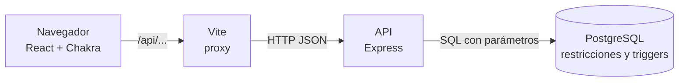
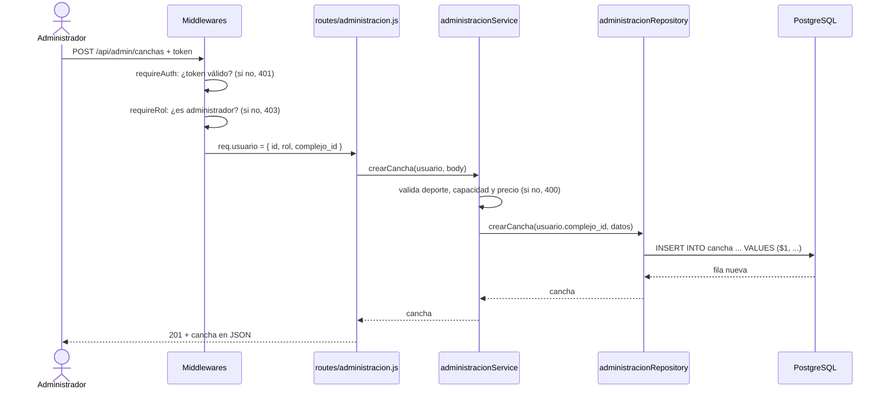
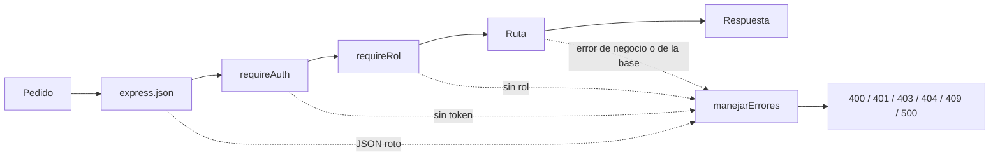
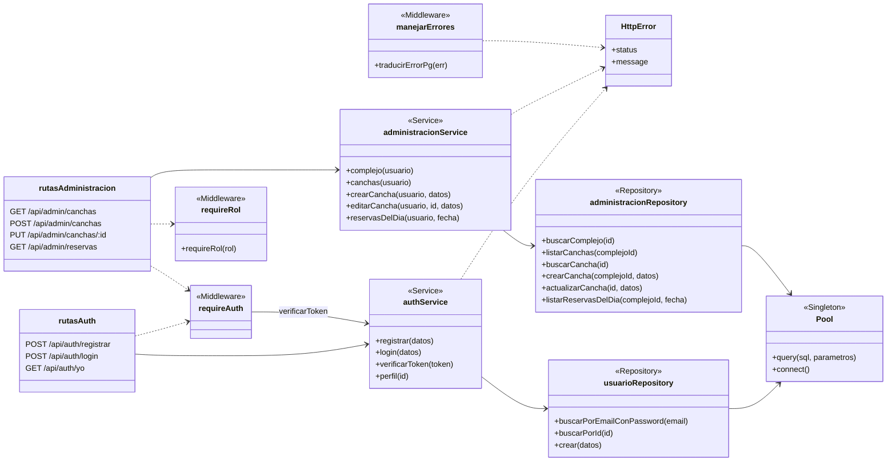
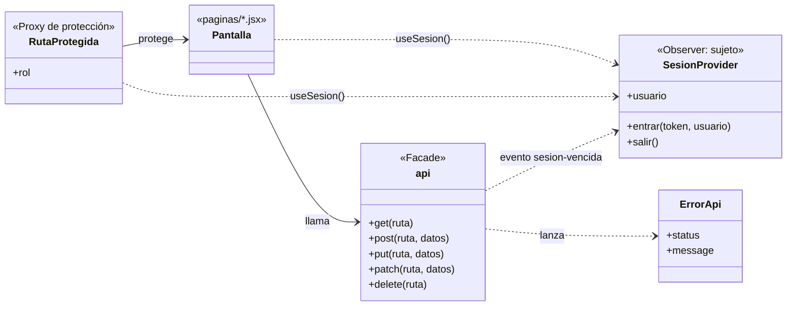

# Arquitectura

Cómo está organizado Turnito, qué patrones de diseño usa y por qué. Las reglas que viven en la base de datos (restricción de solape y triggers) están analizadas en [`decisiones-diseño.md`](decisiones-diseño.md); este documento cubre la API y el front.

## 1. Vista general



- El navegador nunca le habla a la API directo: llama a `/api/...` en su mismo origen y Vite lo reenvía. Así no hace falta configurar CORS.
- La API es la única que conoce la base. Valida lo que depende del pedido (quién pide, si el turno ya pasó, si la cancha es de su complejo).
- La base cuida las reglas que no se pueden romper nunca, aunque lleguen dos pedidos a la vez: que dos reservas no se superpongan y que un partido no pase su cupo.

## 2. Capas de la API

Cada pedido recorre tres capas. Cada una tiene una sola razón para cambiar.

| Capa | Carpeta | Responsabilidad | Lo que **no** hace |
|---|---|---|---|
| Rutas | [`api/src/routes/`](../api/src/routes/) | Leer el pedido y responder JSON con el código HTTP | No tiene SQL ni reglas |
| Servicios | [`api/src/services/`](../api/src/services/) | Reglas de negocio: validar, calcular, decidir quién puede hacer qué | No sabe de HTTP ni de SQL |
| Repositorios | [`api/src/repositories/`](../api/src/repositories/) | Consultas SQL, siempre con parámetros `$1`, `$2` | No decide nada |

El recorrido de un pedido real, un administrador que da de alta una cancha:



El complejo de la cancha sale del token (`usuario.complejo_id`), nunca del pedido. Aunque alguien mande `complejo_id: 2` en el body, la cancha queda en su complejo.

## 3. Patrones de diseño

### 3.1 Repository

**Problema.** Si cada ruta escribe su SQL, las consultas quedan desparramadas, repetidas y mezcladas con la lógica. Cambiar una tabla obliga a buscar en todo el código.

**Solución.** Todo el acceso a datos está en los repositorios, con funciones con nombre de negocio: `buscarPorEmailConPassword(email)`, `crearCancha(complejoId, datos)`. El resto del código no sabe que hay SQL.

**Dónde.** [`usuarioRepository.js`](../api/src/repositories/usuarioRepository.js), [`administracionRepository.js`](../api/src/repositories/administracionRepository.js).

**Por qué así.** Decidimos no usar un ORM: con 6 tablas, el SQL directo es más simple y el esquema entero se lee en un archivo. El Repository nos da la ventaja principal de un ORM, que es tener el acceso a datos en un solo lugar, sin agregar una dependencia ni comandos de migración.

### 3.2 Service Layer

**Problema.** Las reglas de negocio tienen que poder leerse y probarse sin pensar en HTTP ni en SQL.

**Solución.** Una capa de servicios entre las rutas y los repositorios. Ejemplos de reglas que viven ahí:

- El registro crea siempre un jugador, aunque el pedido diga otro rol ([`authService.js`](../api/src/services/authService.js)).
- Si el email no existe o la contraseña está mal, el mensaje es el mismo, para no revelar qué emails están registrados.
- Un administrador solo edita canchas de su complejo: 404 si la cancha no existe, 403 si es de otro ([`administracionService.js`](../api/src/services/administracionService.js)).

**Cómo corta un pedido.** Un servicio lanza `throw new HttpError(403, 'mensaje')` ([`errores.js`](../api/src/errores.js)) y el manejador central lo convierte en la respuesta. El servicio no toca `res`.

### 3.3 Chain of Responsibility

**Problema.** Antes de llegar a la ruta, un pedido tiene que pasar varios controles (que el JSON esté bien, que haya sesión, que tenga el rol), y cualquiera de ellos puede rechazarlo. Ponerlos todos adentro de cada ruta los repetiría en todos lados.

**Solución.** Cada control es un eslabón independiente (un middleware de Express). Recibe el pedido y hace una de dos cosas: lo corta con un error o lo pasa al siguiente con `next()`. El último eslabón es el manejador de errores, que atrapa lo que cualquiera de los anteriores haya lanzado.

```js
// api/src/routes/administracion.js
router.use(requireAuth, requireRol('administrador'));
```



**Dónde.** [`middlewares/auth.js`](../api/src/middlewares/auth.js), [`middlewares/errores.js`](../api/src/middlewares/errores.js), [`app.js`](../api/src/app.js) (el orden de la cadena).

**Detalle.** `requireRol('administrador')` es una función que fabrica eslabones: recibe el rol y devuelve el middleware. Con la misma función se arma un control para cualquier rol.

### 3.4 Singleton

**Problema.** Abrir una conexión nueva a PostgreSQL en cada pedido es lento y agota las conexiones de la base.

**Solución.** Un solo `Pool` de conexiones para toda la API, creado una vez en [`db.js`](../api/src/db.js). Todos los repositorios lo importan.

**Cómo garantiza que haya uno solo.** No tiene el `getInstance()` del libro: lo garantiza el sistema de módulos de Node, que ejecuta `db.js` la primera vez que alguien lo importa y a todos los demás les devuelve el mismo objeto. El efecto es el mismo que el del patrón: una única instancia, con un punto de acceso global.

### 3.5 Facade (front)

**Problema.** Cada llamada a la API con `fetch` necesita la URL, los encabezados, el token, convertir a JSON, leer el error y manejar la sesión vencida. Repetido en cada pantalla, son unas 15 líneas por llamada.

**Solución.** [`web/src/api.js`](../web/src/api.js) ofrece una interfaz simple que esconde todo eso:

```js
const canchas = await api.get('/canchas');
await api.post('/reservas', { cancha_id: 1, fecha: '2026-11-25', hora: '19:00' });
```

Si la API responde con error, lanza `ErrorApi` con el `status` y el mensaje, así la pantalla puede mostrar un 409 ("Ese turno ya está reservado") sin conocer `fetch`.

### 3.6 Observer (front)

**Problema.** Varias partes de la pantalla dependen de si hay sesión: la barra de navegación, las rutas protegidas, el perfil. Cuando alguien entra o sale, todas tienen que actualizarse.

**Solución.** La sesión es el sujeto observado ([`web/src/sesion.jsx`](../web/src/sesion.jsx)). Cada componente que llama a `useSesion()` queda suscripto, y React lo vuelve a dibujar cuando la sesión cambia. Quien cambia la sesión no conoce a los suscriptores.

El mismo mecanismo conecta `api.js` con la sesión: si la API responde 401, `api.js` emite el evento `sesion-vencida` y la sesión, que lo escucha, se cierra. `api.js` no depende de React.

### 3.7 Proxy de protección (front)

**Problema.** Algunas pantallas solo se pueden ver con sesión, y `/admin` solo con rol de administrador. El control no tiene que estar repetido adentro de cada pantalla.

**Solución.** [`RutaProtegida`](../web/src/componentes/RutaProtegida.jsx) se pone delante de las pantallas y controla el acceso antes de mostrarlas: sin sesión manda al login (recordando a dónde quería ir), y sin el rol manda al inicio. Las pantallas no saben que están protegidas. Es la idea del Proxy de protección: un intermediario con la misma "interfaz" (una ruta) que decide si deja pasar.

```jsx
<Route element={<RutaProtegida rol="administrador" />}>
  <Route path="admin" element={<Administracion />} />
</Route>
```

### 3.8 En la base de datos

Las reglas de la base (restricción de exclusión contra reservas superpuestas, triggers con una sola responsabilidad que reaccionan a eventos, bloqueo de la fila del partido para el cupo) están analizadas en [`decisiones-diseño.md`](decisiones-diseño.md).

## 4. Diagrama de clases

En JavaScript estos componentes son módulos con funciones y no clases, pero cumplen el mismo rol. El diagrama muestra cada módulo como una clase con sus operaciones públicas.



Y del lado del front:



## 5. Manejo de errores

Todos los errores salen de un solo lugar ([`middlewares/errores.js`](../api/src/middlewares/errores.js)) con el mismo formato: `{ "error": "mensaje" }`.

| Origen | Ejemplo | Respuesta |
|---|---|---|
| Un servicio lanza `HttpError` | Cancha de otro complejo | El código que eligió el servicio (403) |
| JSON mal formado | `{ roto` | 400 |
| Restricción de solape (`23P01`) | Dos reservas en el mismo turno | 409 "Ese turno ya está reservado" |
| Dato único repetido (`23505`) | Email ya registrado | 409 con un mensaje según la restricción |
| Trigger de cupo (`23514` sin restricción) | Partido lleno | 409 "El partido ya no tiene lugar" |
| `CHECK` de una tabla (`23514` con restricción) | Capacidad 0 | 400 |
| Cualquier otro | Error de programación | 500, y se registra en la consola de la API |

Que la base rechace y la API traduzca es lo que hace seguras las reglas aunque lleguen dos pedidos al mismo tiempo: la API no tiene que consultar antes de escribir, que es justo donde aparecen las condiciones de carrera.

## 6. Reservas

> Pendiente: ticket F9 (#26). Diagrama de secuencia de una reserva pasando por las capas hasta la restricción de la base.

## 7. Partidos

> Pendiente: ticket N9 (#35). Diagrama de secuencia de "sumarse", incluido el bloqueo de la fila que evita pasarse del cupo.
